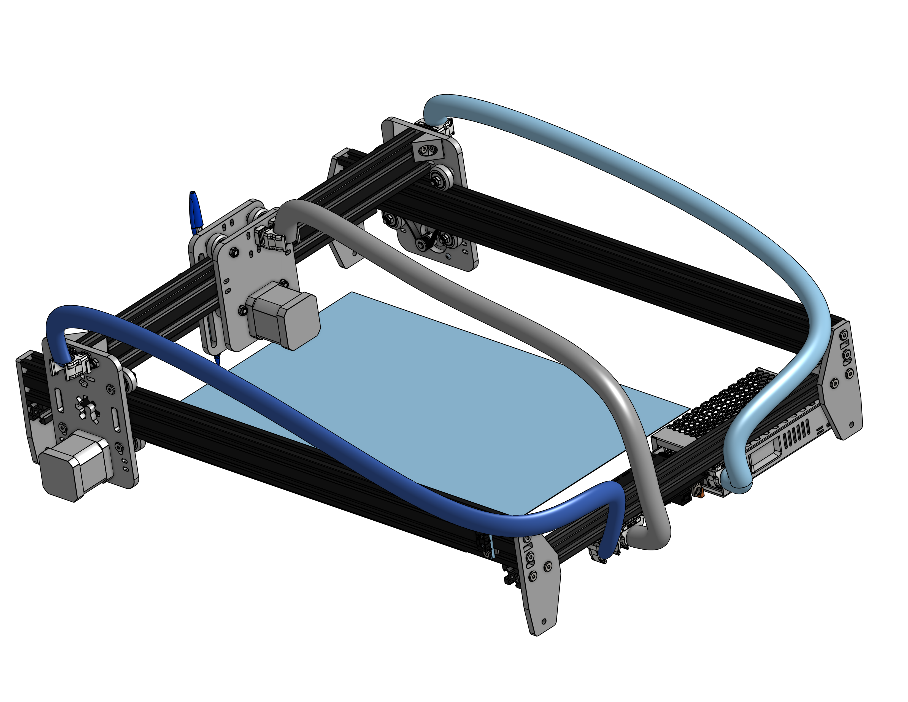
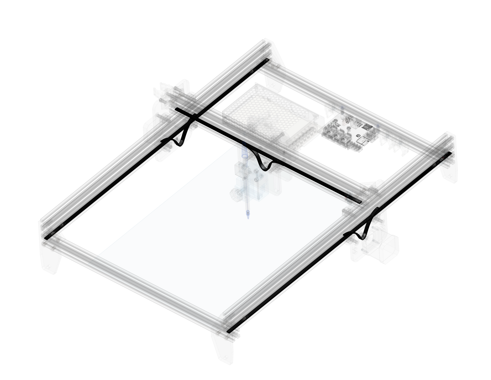
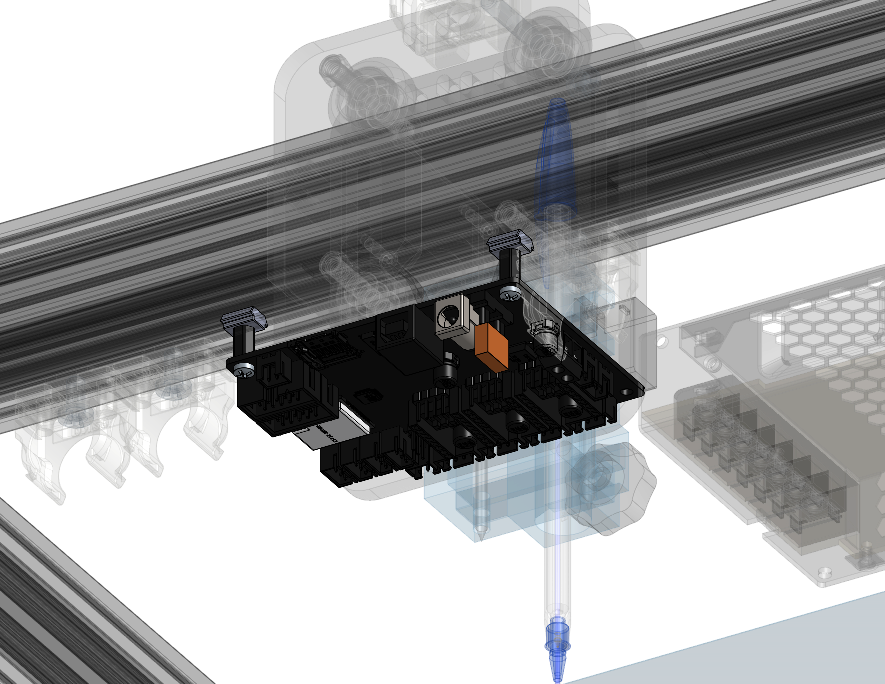
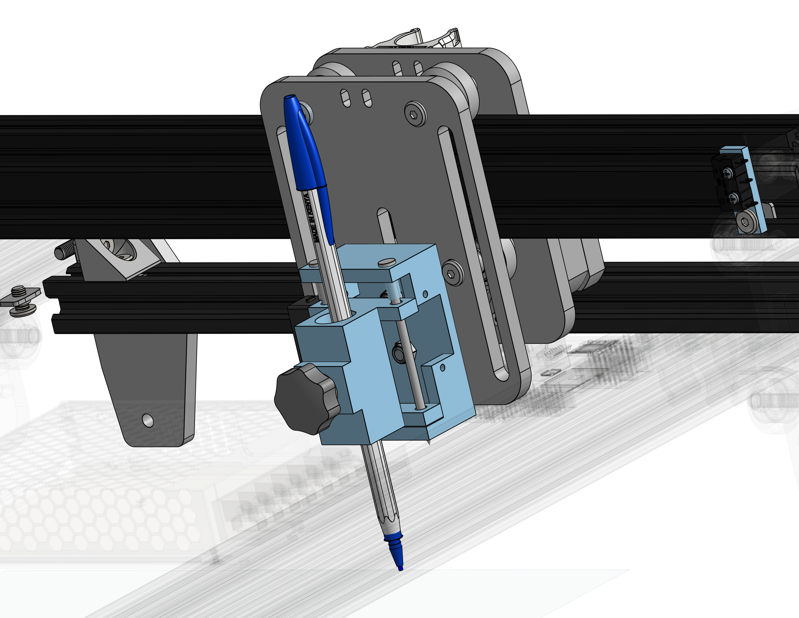

# CNC Pen Ploter

this is an A3 CNC pen plotter inspired by the OpenBuilds ACRO system and designed for handwriting, drawing, and future painting experiments.

The machine uses a V-slot motion system, FluidNC firmware, and a custom servo-powered pen-lift mechanism.

## Features

* A3 drawing area
* FluidNC controller
* MKS DLC32 V2.1
* Servo pen lift
* GT2 belt drive
* V-slot aluminum extrusion frame
* Future laser upgrade support

## Specifications

| Item          | Value                                   |
| ------------- | --------------------------------------- |
| Working Area  | A3                                      |
| Motion System | GT2 Belt Drive                          |
| Controller    | MKS DLC32 V2.1                          |
| Firmware      | FluidNC                                 |
| Motors        | 3 × NEMA17 Stepper Motors               |
| Pen Lift      | SG90 Servo                              |
| Frame         | 2020 / 2040 V-Slot Aluminium Extrusions |
| Power Supply  | Meanwell LRS-150-24                     |

## Bill of Materials

Detailed BOM files:

* [Cost Summary](./BOM/Cost-Summary.md)
* [BOM Spreadsheet](./BOM/BOM.xlsx)
* [BOM CSV](./BOM/BOM.csv)

### Project Cost

**Total Build Cost:** ₹21,765.83 (~$220.67 USD)

## CAD Files

The complete CAD assembly, source files, and design history are available on Onshape:

* [View Onshape Project](https://cad.onshape.com/documents/d076f74775598c2c224d3ddc/w/a742f32d9e5f68d3a0ed4f3e/e/59cbca8dd54cfc34bc3f8ac0?renderMode=0&leftPanel=false&uiState=6a25ab40411915944ca1e2be)

3D printable components can be found here:

* [Printed Parts](./3D%20print/Printed%20Parts.md)

## Electronics

*Wiring diagrams* (still pending), controller configuration files, and FluidNC settings are located in the [`Firmware`](./Firmware/README.md) directory.

## Build Status

* [x] CAD Design Complete
* [x] Bill of Materials Complete
* [ ] Parts Ordered
* [ ] Parts Received
* [ ] Assembly Complete
* [ ] Electronics Wired
* [ ] First Motion Test
* [ ] First Drawing

## Gallery

### CAD Animation

* [Watch Demo Video](https://www.youtube.com/watch?v=2c1DS8Nv8dU)

* [Devlopment](./Images/timeline.md)

|                                                                                                                   |                                                                                                                   |
| ----------------------------------------------------------------------------------------------------------------- | ----------------------------------------------------------------------------------------------------------------- |
|  |  |
|  |  |

|                                                                                                                   |                                                                                                                   |
| ----------------------------------------------------------------------------------------------------------------- | ----------------------------------------------------------------------------------------------------------------- |
|  |  |
|  |  |

---

## License

This project is licensed under the CERN Open Hardware Licence Version 2 - Strongly Reciprocal (CERN-OHL-S v2).

See [LICENSE.md](./LICENSE.md) for details.
